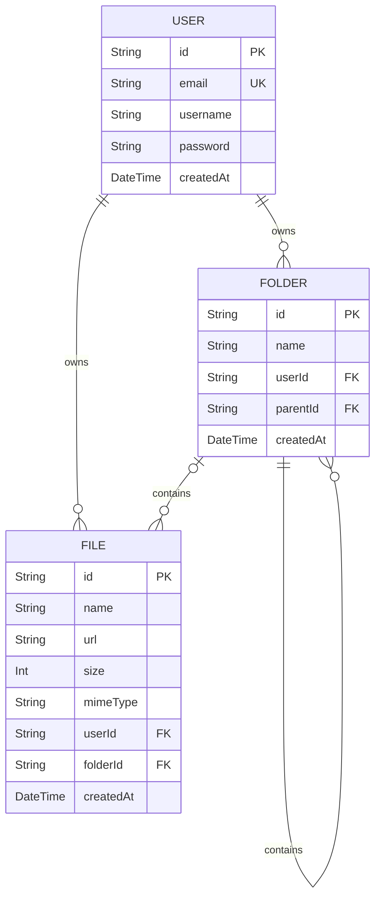

# UDrive

UDrive is a web application that allows registered user to upload files(up to 50mb total and 5mb each), with the ability to CRUD folders and organize files into and out of them.

---

## Table of Contents

- [Features](#features)
- [Tech Stack](#tech-stack)
- [Project Structure](#project-structure)
- [Database Architecture](#database-architecture)
- [Application Routes](#application-routes)
- [Roadmap](#roadmap)

---

## Features

- ** User Authentication:** Secure registration and login.
- ** Multi-Tier Nested Folder Management (CRUD):** Users can Create, Read, Update, and Delete folders at the root level or inside any other folder, supporting an infinite directory tree.
- ** File Organization:** Assign or add files to folders. Users can freely move files between specific folders or back out to the root directory.
- ** Dynamic Storage Controls (50MB Limit):**
  - User storage consumption is calculated dynamically via database aggregation (`SUM`) on demand.
  - Enforces a strict total quota of **50 MB** per user.
  - Supported Formats:
    - **Images:** `.jpeg`, `.png`, `.webp` (MIME: `image/jpeg`, `image/png`, `image/webp`)
    - **Documents:** `.pdf`, `.doc`, `.docx` (MIME: `application/pdf`, `application/msword`, etc.)

---

## Tech Stack

| Layer        | Technology             |
| ------------ | ---------------------- |
| Runtime      | Node.js (ESM)          |
| Framework    | Express 5              |
| Templating   | EJS                    |
| Styling      | Vanilla CSS            |
| ORM          | Prisma 7               |
| Database     | PostgreSQL             |
| File Storage | Cloudinary             |
| Auth         | Passport.js & bcryptjs |
| Validation   | express-validator      |
| File Uploads | Multer                 |

---

## Project Structure

```

UDrive/
├── app.js # Express app setup (middleware, routes, passport)
├── server.js # HTTP server entry point
├── prisma/
│ └── schema.prisma # Database schema (User, Directory, File, Session)
├── generated/prisma/ # Auto-generated Prisma client
├── db/
│ ├── user.js # User DB queries
│ ├── directory.js # Directory DB queries
│ └── file.js # File DB queries
├── controllers/ # Route handler logic
├── routes/ # Express routers
├── middlewares/ # Auth guards, error handlers
├── validators/ # express-validator
├── views/ # EJS templates
├── public/ # Static assets (CSS, images...)
├── config/ # Passport strategy, session config
└── lib/ # Shared utilities

```

---

## Database Architecture

The system uses a 3-table relational schema designed to map out a multi-tier nested directory structure where folders can contain other sub-folders where files can either belong to a folder or float independently in the root directory.

### 1. UML Class Diagram



### 2. Table Specifications

#### User

Stores secure user credentials. Cascade deletes are tied to this table to ensure all dependent folders and files are purged if an account is deleted.

| Field       | Type     | Attributes      | Description                      |
| :---------- | :------- | :-------------- | :------------------------------- |
| `id`        | String   | @id, UUID       | Unique user identifier           |
| `email`     | String   | @unique         | User login credential            |
| `password`  | String   | Encrypted       | Hashed password string (Bcrypt)  |
| `role`      | String   | -               | User role (admin, user(default)) |
| `createdAt` | DateTime | @default(now()) | Account registration timestamp   |

#### Folder

Can be created at the root level or nested inside another folder to support a multi-tier directory structure. Cascade deletes are configured so that deleting a parent folder automatically purges all its sub-folders and contained files.

| Field       | Type     | Attributes               | Description                              |
| :---------- | :------- | :----------------------- | :--------------------------------------- |
| `id`        | String   | @id, UUID                | Unique folder identifier                 |
| `name`      | String   | -                        | Custom folder name                       |
| `userId`    | String   | FK (User.id)             | Owner identifier                         |
| `parentId`  | String?  | FK (Folder.id), Optional | Parent folder; `null` if located at root |
| `createdAt` | DateTime | @default(now())          | Folder creation timestamp                |

#### File

Stores file metadata. The physical object is hosted on cloud storage, while this table links the access `url`. An optional `folderId` maps its location.

| Field       | Type     | Attributes               | Description                              |
| :---------- | :------- | :----------------------- | :--------------------------------------- |
| `id`        | String   | @id, UUID                | Unique file identifier                   |
| `name`      | String   | -                        | File name with extension                 |
| `url`       | String   | -                        | Cloud storage object downland URL        |
| `size`      | Int      | -                        | File size in Bytes                       |
| `mimeType`  | String   | -                        | File media type (e.g., `image/png`)      |
| `userId`    | String   | FK (User.id)             | Uploader identifier                      |
| `folderId`  | String?  | FK (Folder.id), Optional | Parent folder; `null` if located at root |
| `createdAt` | DateTime | @default(now())          | Upload timestamp                         |

---

## Application Routes

Since **UDrive** uses **EJS** for Server-Side Rendering (SSR), page navigation and backend data mutations are integrated within the same Express framework.

### Authentication (`/auth`)

| Method | Endpoint       | Access | Description                                    |
| :----- | :------------- | :----- | :--------------------------------------------- |
| `GET`  | `/auth/signup` | Public | Renders the registration form page             |
| `POST` | `/auth/signup` | Public | Handles account creation and password hashing  |
| `GET`  | `/auth/login`  | Public | Renders the credentials sign-in page           |
| `POST` | `/auth/login`  | Public | Validates login and sets cookie-based session  |
| `POST` | `/auth/logout` | Auth   | Destroys active session and redirects to login |

### Folder Management (`/folders`)

| Method | Endpoint              | Access | Description                                                                                                             |
| :----- | :-------------------- | :----- | :---------------------------------------------------------------------------------------------------------------------- |
| `GET`  | `/folders/:id`        | Auth   | **Inside Folder View.** Displays sub-folders and files nested under the target directory, along with a breadcrumb path. |
| `POST` | `/folders`            | Auth   | Creates a new folder (supports creating sub-folders if parentId is provided)                                            |
| `POST` | `/folders/:id/update` | Auth   | Renames an existing folder metadata entity                                                                              |
| `POST` | `/folders/:id/delete` | Auth   | Deletes folder and triggers Prisma cascade file purge                                                                   |

### File Management (`/files`)

| Method | Endpoint              | Access        | Description                                                                                             |
| :----- | :-------------------- | :------------ | :------------------------------------------------------------------------------------------------------ |
| `GET`  | `/files/:id`          | Auth          | **File Inspector.** Renders detail modal for viewing file details.                                      |
| `POST` | `/files/upload`       | Multer + Auth | Validates 50MB cap / 5MB single file check. Commits metadata via Prisma and pipes binary to Cloudinary. |
| `GET`  | `/files/:id/download` | Auth          | Validates ownership and streams binary payload via backend.                                             |
| `GET`  | `/files/:id/update`   | Auth          | Returns current file metadata as JSON to pre-populate editing form modals.                              |
| `POST` | `/files/:id/update`   | Auth          | Modifies active file parameters (renaming or altering `folderId` path placement).                       |
| `POST` | `/files/:id/delete`   | Auth          | Purges file record from database and destroys physical object in Cloudinary.                            |

### Dashboard & File Management (`/`)

| Method | Endpoint | Access  | Description                                                                                                                 |
| :----- | :------- | :------ | :-------------------------------------------------------------------------------------------------------------------------- |
| `GET`  | `/`      | Mixed\* | **Root Dashboard.** Shows entry portal if guest, or renders folders, root files, and dynamic 50MB tracker if authenticated. |

---

## Roadmap

The following features are planned for future releases:

- **Admin role** — Admins will have access to detailed statistics, user management, and advanced settings.

- **Directory Sharing** — Share directories with other users via invite links or direct user access grants, with configurable permission levels (view / edit).

- **File Upload Drag & Drop** - Drag and drop files into the browser to upload them.

---
